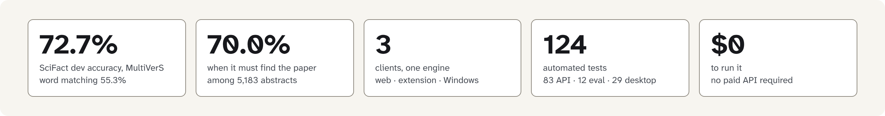
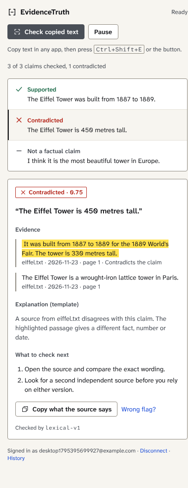
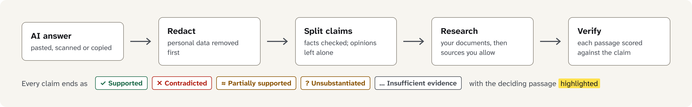
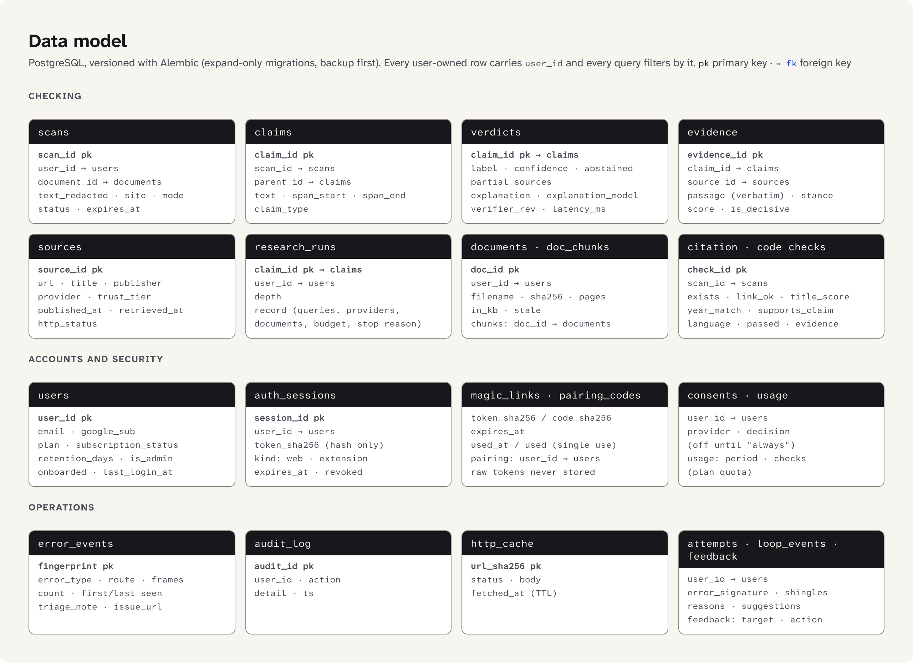
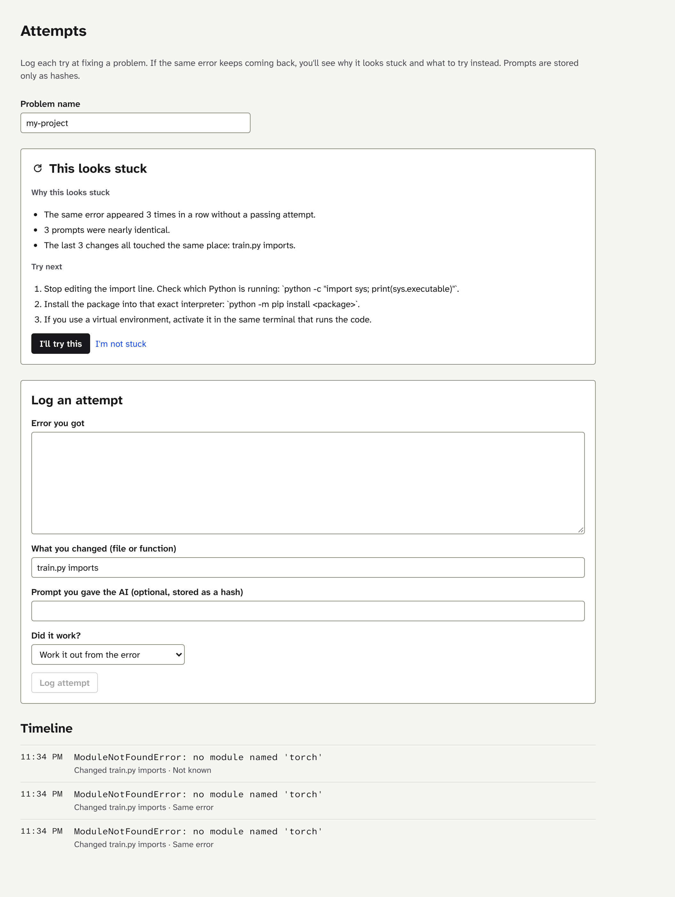
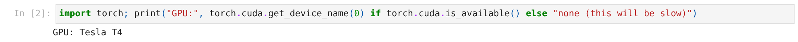
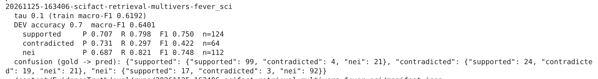
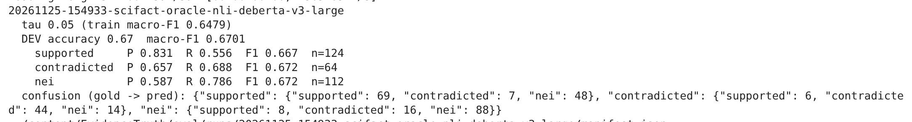
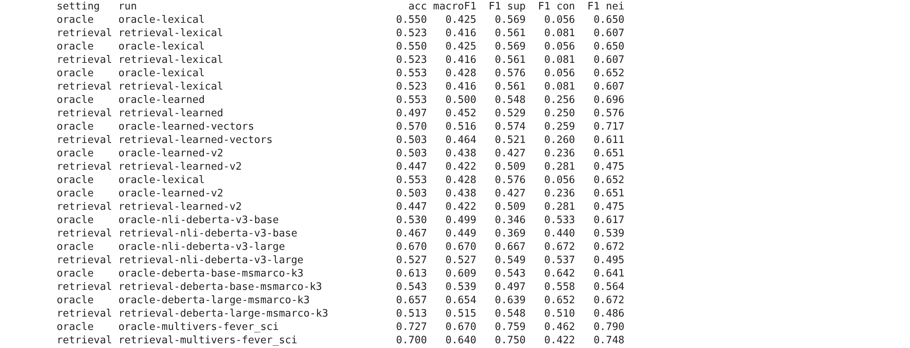

  

  
  
  
  
   
  
  
  
  
  
  
  
  
  
  
  
  

  

  <b>Every claim gets a verdict and the exact passage that decided it, quoted word for word.</b> 
  <a href="#see-it">See it</a> ·
  <a href="#inside-the-backend">Backend</a> ·
  <a href="#how-it-works">How it works</a> ·
  <a href="#architecture">Architecture</a> ·
  <a href="#measured-accuracy">Accuracy</a> ·
  <a href="#skills-and-tools">Skills and tools</a>

<picture>
  <source media="(prefers-color-scheme: dark)" srcset="docs/images/at-a-glance-dark.png">
  
</picture>

## The problem

AI answers sound equally sure when they are wrong. **EvidenceTruth checks each claim and shows the source sentence that decided it.**

<picture>
  <source media="(prefers-color-scheme: dark)" srcset="docs/images/results-dark.png">
  
</picture>

## See it

<table>
<tr>
<th width="33%">Web app</th>
<th width="33%">Browser extension</th>
<th width="33%">Windows desktop app</th>
</tr>
<tr>
<td valign="top"></td>
<td valign="top" align="center"></td>
<td valign="top" align="center"></td>
</tr>
<tr>
<td valign="top">Paste an answer, add your PDFs and documents, read full reports, history and a dashboard.</td>
<td valign="top">Scan a ChatGPT, Claude or Gemini page. Checked sentences are underlined in place.</td>
<td valign="top">Copy text in <b>any</b> app and press <kbd>Ctrl</kbd>+<kbd>Shift</kbd>+<kbd>E</kbd>. Right-click the floating button for Check, Hide and Quit.</td>
</tr>
</table>

 
The extension underlines checked sentences without changing the page.

## How it works

<picture>
  <source media="(prefers-color-scheme: dark)" srcset="docs/images/how-it-works-dark.png">
  
</picture>

| Verdict | Meaning |
|---|---|
| **Supported** | A trusted source says the same thing |
| **Contradicted** | A trusted source gives a different fact, number or date |
| **Partially supported** | The sentence makes several claims; some are confirmed, some are not (each part is shown) |
| **Unsubstantiated** | Trustworthy sources cover the topic, but none confirms this claim |
| **Insufficient evidence** | Nothing relevant was found, or it was too weak. *That doesn't mean it's false.* |

### How one claim is researched

<picture>
  <source media="(prefers-color-scheme: dark)" srcset="docs/images/research-dark.png">
  
</picture>

## Architecture

<picture>
  <source media="(prefers-color-scheme: dark)" srcset="docs/images/architecture-dark.png">
  
</picture>

## Inside the backend

<picture>
  <source media="(prefers-color-scheme: dark)" srcset="docs/images/request-lifecycle-dark.png">
  
</picture>

<picture>
  <source media="(prefers-color-scheme: dark)" srcset="docs/images/data-model-dark.png">
  
</picture>

<table>
<tr>
<td width="50%"><picture><source media="(prefers-color-scheme: dark)" srcset="docs/images/security-dark.png"></picture></td>
<td width="50%"><picture><source media="(prefers-color-scheme: dark)" srcset="docs/images/delivery-dark.png"></picture></td>
</tr>
</table>

<b>Engineering details</b> (stack, security, tests, CI)

| Area | What's in place |
|---|---|
| **Backend** | FastAPI, Pydantic v2, SQLAlchemy 2, PostgreSQL (+ pgvector), Alembic. Pure `core/` with no I/O; network only in `sources/` |
| **Research engine** | Query directions, one `SearchProvider` interface (Wikipedia, Semantic Scholar, arXiv, self-hosted SearXNG), budgets, source-independence groups, injection set-aside, per-claim research record |
| **Frontend** | React 19, React Router 7, Vite, strict TypeScript. Own component set on design tokens |
| **Extension** | Manifest V3: side panel, context menu, CSS Custom Highlight API for underlines |
| **Desktop** | Electron: floating button with menu, tray, global shortcut, token encrypted by the OS, HTTPS only, version check and update offer |
| **Auth** | Passwordless email links and Google (PKCE). Hashed server-side sessions, CSRF protection, revocable devices |
| **Security** | SSRF guard, strict CSP, rate limits, redaction before storage, tenant isolation, sandboxed renderers, validated IPC |
| **Billing** | Free and Pro plans with server-side quotas; Stripe Checkout, Customer Portal and signed webhooks |
| **Tests** | 83 backend tests on SQLite and PostgreSQL (auth, CSRF, tenant isolation, privacy, prompt injection, SSRF, billing, migrations, research failures and budgets). Web, extension and desktop unit tests. Playwright walkthroughs of the real web app, extension and Electron app |
| **CI on every PR** | Lint, types, tests, secret scan, dependency audit, OpenAPI breaking-change check, UI anti-slop check, browser walkthroughs, Docker build |
| **Safe migrations** | Backup first; destructive SQL fails CI without an approval label; the runner needs a one-time code typed by a person |
| **Production errors** | Grouped by fingerprint, scrubbed of user data; a daily triage job files issues with the likely cause |

Write-ups: [Architecture](docs/ARCHITECTURE.md) · [Security](docs/SECURITY.md) · [API reference](docs/api/openapi.json) · [Results](docs/RESULTS.md)

## More than facts

<table>
<tr>
<td width="50%" valign="top"><b>Code that imports things that don't exist</b> Every import is checked against the real PyPI or npm registry. Code is never run.  </td>
<td width="50%" valign="top"><b>Repeated failed fixes</b> When the same error keeps coming back, it explains why it looks stuck and suggests a different experiment.  </td>
</tr>
<tr>
<td valign="top"><b>Your history, counted honestly</b> Every number on the dashboard comes from stored checks.  </td>
<td valign="top"><b>Also</b> Citations: does the paper exist, do title, authors and year match Documents: compare an answer with your PDF or DOCX Calculations: arithmetic, percentages, unit conversions A chat that answers only from stored evidence</td>
</tr>
</table>

## Measured accuracy

SciFact dev split (300 expert-labelled scientific claims), never used for training or tuning. One notebook run on a
free Colab T4 GPU, 25 Nov 2026. Full table with per-class scores: [docs/RESULTS.md](docs/RESULTS.md).

| Verifier | Accuracy (cited abstract) | Accuracy (search all 5,183) | Macro-F1 | Contradiction F1 |
|---|---|---|---|---|
| Majority class | | | 0.195 | |
| Word matching (transparent baseline) | 55.3% | 52.3% | 0.428 | 0.06 |
| DeBERTa-v3-base, 3 selected sentences | 61.3% | 54.3% | 0.609 | 0.64 |
| DeBERTa-v3-large | 67.0% | 52.7% | 0.670 | **0.67** |
| **MultiVerS** (never trained on SciFact) | **72.7%** | **70.0%** | **0.670** | 0.46 |

MultiVerS is the most accurate and keeps its accuracy when it has to find the paper itself; DeBERTa-v3-large is the
strongest at spotting contradictions.

### Benchmark evidence
Raw, unedited output from the evaluation notebook on Google Colab. Each run prints the threshold chosen on training
data, accuracy, per-class precision, recall and F1, and the confusion matrix.

<b>More runs: MultiVerS with search, DeBERTa-v3-large, and the summary of every run</b>

## Skills and tools

| Area | Used in this project |
|---|---|
| Languages |       |
| Backend |        |
| Machine learning and NLP |         |
| Frontend |     |
| Clients |    |
| Security |     |
| Payments and email |   |
| Testing |      |
| DevOps |     |

<b>Privacy by design</b>

- Emails, API keys, card and phone numbers are **redacted before** anything is stored or sent.
- Every public source is **off** until you allow it; only the claim's own words are sent.
- The extension and desktop app read only what you ask them to check: no screenshots, no screen watching, no keystrokes.
- History is deleted after 30 days by default. Export or delete everything at any time.

## Prototype scope

| What it does | What it does not claim |
|---|---|
| Checks factual claims, citations, documents, code imports and calculations, and shows the deciding source sentence | To catch every wrong answer: *Unsubstantiated* and *Insufficient evidence* mean "not confirmed", not "false" |
| Runs on free infrastructure with a transparent word-matching verifier, small enough for a free host | The MultiVerS and DeBERTa figures above come from the offline benchmark on a GPU, not from the free deployed instance |
| Web app, Chrome extension and Windows desktop app on one account and one engine | Certified handling of regulated data (health records, card numbers, government IDs) |

## What is in this repository

| Public here | Private |
|---|---|
| Web app (React), Chrome extension, Windows desktop app (Electron), shared UI and design system | Verification engine: claim extraction, research, evidence selection, verdict rules |
| API layer, sign-in and sessions, plans and payments, database models and migrations, security middleware | Engine tests and the evaluation and training code |
| Browser walkthroughs, Docker and deployment files, architecture and security write-ups, API reference | Internal design notes and tuning |

If you are reviewing my work for a role, open an issue or message me through my GitHub profile and I will give you read access to the full repository or walk you through the code.

## Licence

All rights reserved. The code, text, diagrams and screenshots here may be viewed on GitHub; any other use needs
written permission. See [LICENSE](LICENSE).

If this project is interesting to you, a star helps others find it.

