

  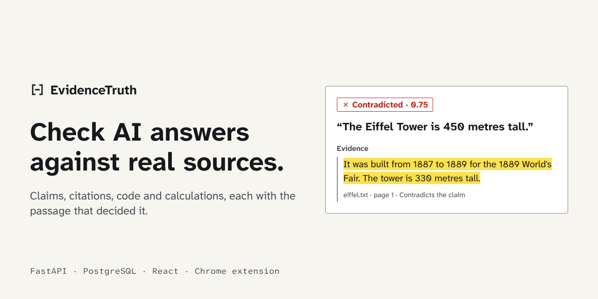

  
  
  
   
  
  
  
  
  
  
  
  
  
  
  
  

  <b>Every claim gets a verdict and the exact passage that decided it, quoted word for word.</b> 
  <a href="#see-it">See it</a> ·
  <a href="#inside-the-backend">Backend</a> ·
  <a href="#how-it-works">How it works</a> ·
  <a href="#architecture">Architecture</a> ·
  <a href="#measured-accuracy">Accuracy</a>

<picture>
  <source media="(prefers-color-scheme: dark)" srcset="docs/images/at-a-glance-dark.png">
  
</picture>

## The problem

AI answers sound equally sure when they are wrong. **EvidenceTruth checks each claim and shows the source sentence that decided it.**

<picture>
  <source media="(prefers-color-scheme: dark)" srcset="docs/images/results-dark.png">
  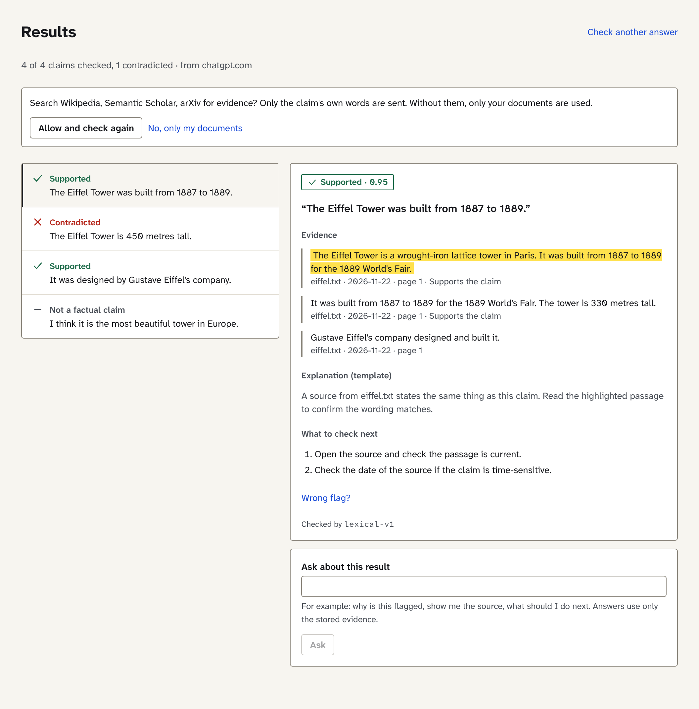
</picture>

## See it

<table>
<tr>
<th width="33%">Web app</th>
<th width="33%">Browser extension</th>
<th width="33%">Windows desktop app</th>
</tr>
<tr>
<td valign="top">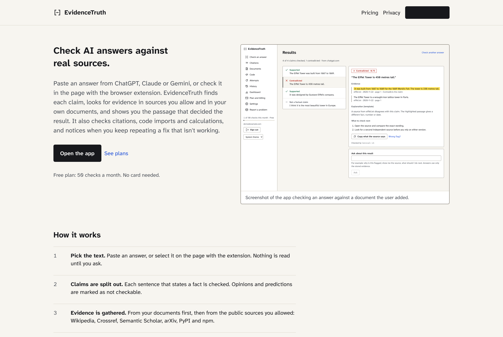</td>
<td valign="top" align="center">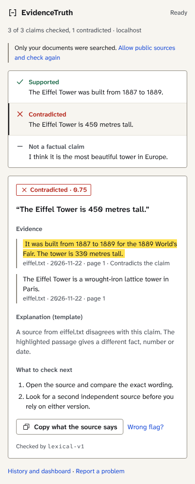</td>
<td valign="top" align="center"></td>
</tr>
<tr>
<td valign="top">Paste an answer, add your PDFs and documents, read full reports, history and a dashboard.</td>
<td valign="top">Scan a ChatGPT, Claude or Gemini page. Checked sentences are underlined in place.</td>
<td valign="top">Copy text in <b>any</b> app and press <kbd>Ctrl</kbd>+<kbd>Shift</kbd>+<kbd>E</kbd>. Right-click the floating button for Check, Hide and Quit.</td>
</tr>
</table>

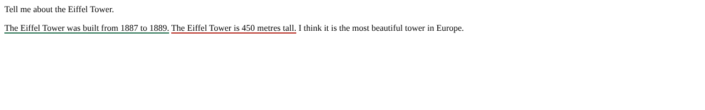 
The extension underlines checked sentences without changing the page.

## How it works

<picture>
  <source media="(prefers-color-scheme: dark)" srcset="docs/images/how-it-works-dark.png">
  
</picture>

| Verdict | Meaning |
|---|---|
| **Supported** | A trusted source says the same thing |
| **Contradicted** | A trusted source gives a different fact, number or date |
| **Partially supported** | The sentence makes several claims; some are confirmed, some are not (each part is shown) |
| **Unsubstantiated** | Trustworthy sources cover the topic, but none confirms this claim |
| **Insufficient evidence** | Nothing relevant was found, or it was too weak. *That doesn't mean it's false.* |

### How one claim is researched

<picture>
  <source media="(prefers-color-scheme: dark)" srcset="docs/images/research-dark.png">
  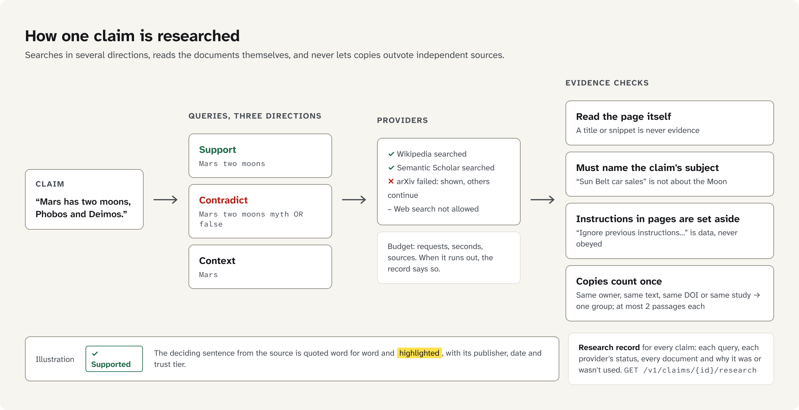
</picture>

## Architecture

<picture>
  <source media="(prefers-color-scheme: dark)" srcset="docs/images/architecture-dark.png">
  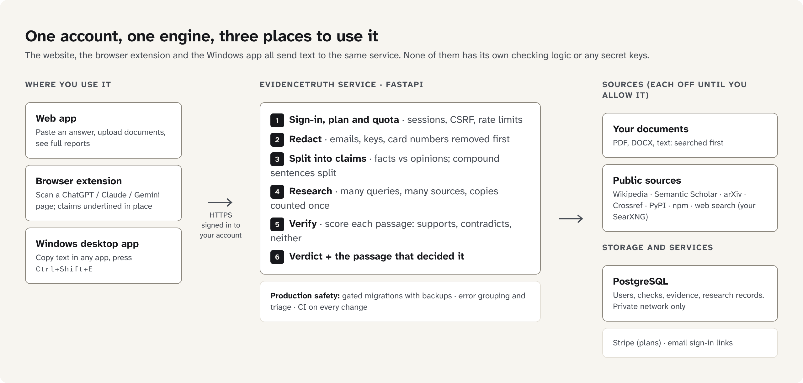
</picture>

## Inside the backend

<picture>
  <source media="(prefers-color-scheme: dark)" srcset="docs/images/request-lifecycle-dark.png">
  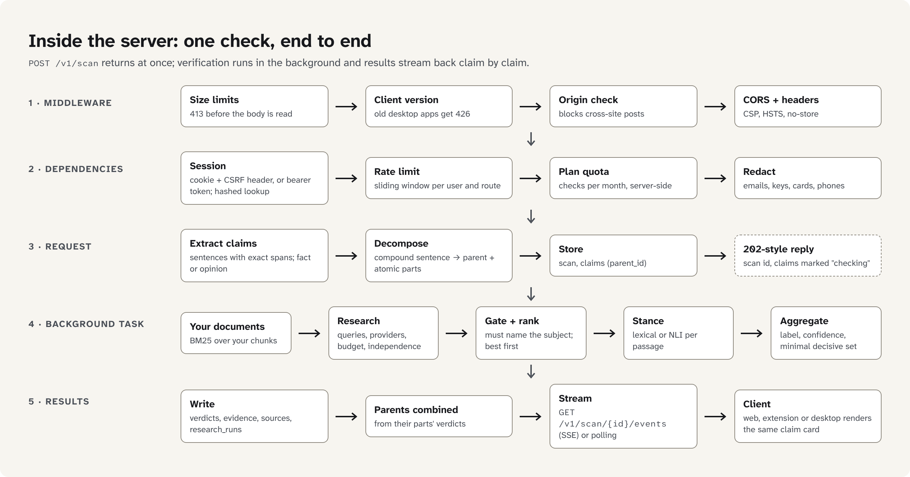
</picture>

<picture>
  <source media="(prefers-color-scheme: dark)" srcset="docs/images/data-model-dark.png">
  
</picture>

<table>
<tr>
<td width="50%"><picture><source media="(prefers-color-scheme: dark)" srcset="docs/images/security-dark.png">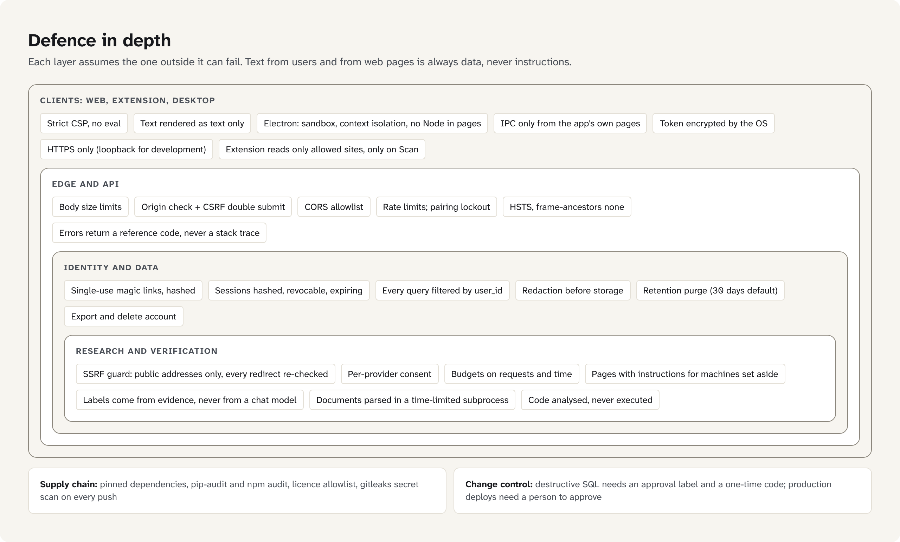</picture></td>
<td width="50%"><picture><source media="(prefers-color-scheme: dark)" srcset="docs/images/delivery-dark.png">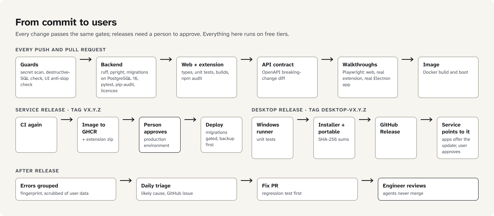</picture></td>
</tr>
</table>

<b>Engineering details</b> (stack, security, tests, CI)

| Area | What's in place |
|---|---|
| **Backend** | FastAPI, Pydantic v2, SQLAlchemy 2, PostgreSQL (+ pgvector), Alembic. Pure `core/` with no I/O; network only in `sources/` |
| **Research engine** | Query directions, one `SearchProvider` interface (Wikipedia, Semantic Scholar, arXiv, self-hosted SearXNG), budgets, source-independence groups, injection set-aside, per-claim research record |
| **Frontend** | React 19, React Router 7, Vite, strict TypeScript. Own component set on design tokens |
| **Extension** | Manifest V3: side panel, context menu, CSS Custom Highlight API for underlines |
| **Desktop** | Electron: floating button with menu, tray, global shortcut, token encrypted by the OS, HTTPS only, version check and update offer |
| **Auth** | Passwordless email links and Google (PKCE). Hashed server-side sessions, CSRF protection, revocable devices |
| **Security** | SSRF guard, strict CSP, rate limits, redaction before storage, tenant isolation, sandboxed renderers, validated IPC |
| **Billing** | Free and Pro plans with server-side quotas; Stripe Checkout, Customer Portal and signed webhooks |
| **Tests** | 81 backend tests on SQLite and PostgreSQL (auth, CSRF, tenant isolation, privacy, prompt injection, SSRF, billing, migrations, research failures and budgets). Web, extension and desktop unit tests. Playwright walkthroughs of the real web app, extension and Electron app |
| **CI on every PR** | Lint, types, tests, secret scan, dependency audit, OpenAPI breaking-change check, UI anti-slop check, browser walkthroughs, Docker build |
| **Safe migrations** | Backup first; destructive SQL fails CI without an approval label; the runner needs a one-time code typed by a person |
| **Production errors** | Grouped by fingerprint, scrubbed of user data; a daily triage job files issues with the likely cause |

Write-ups: [Architecture](docs/ARCHITECTURE.md) · [Security](docs/SECURITY.md) · [API reference](docs/api/openapi.json) · [Results](docs/RESULTS.md)

## More than facts

<table>
<tr>
<td width="50%" valign="top"><b>Code that imports things that don't exist</b> Every import is checked against the real PyPI or npm registry. Code is never run.  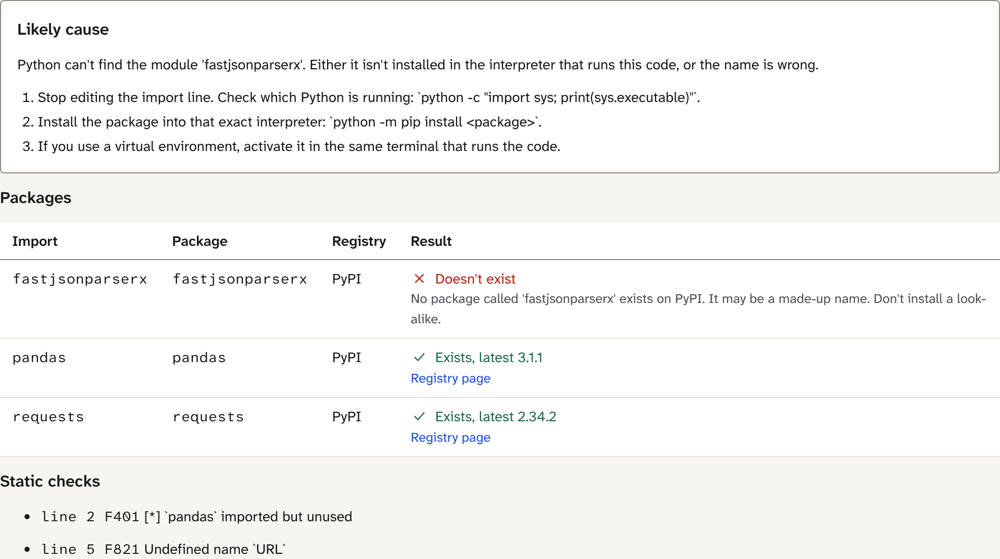</td>
<td width="50%" valign="top"><b>Repeated failed fixes</b> When the same error keeps coming back, it explains why it looks stuck and suggests a different experiment.  </td>
</tr>
<tr>
<td valign="top"><b>Your history, counted honestly</b> Every number on the dashboard comes from stored checks.  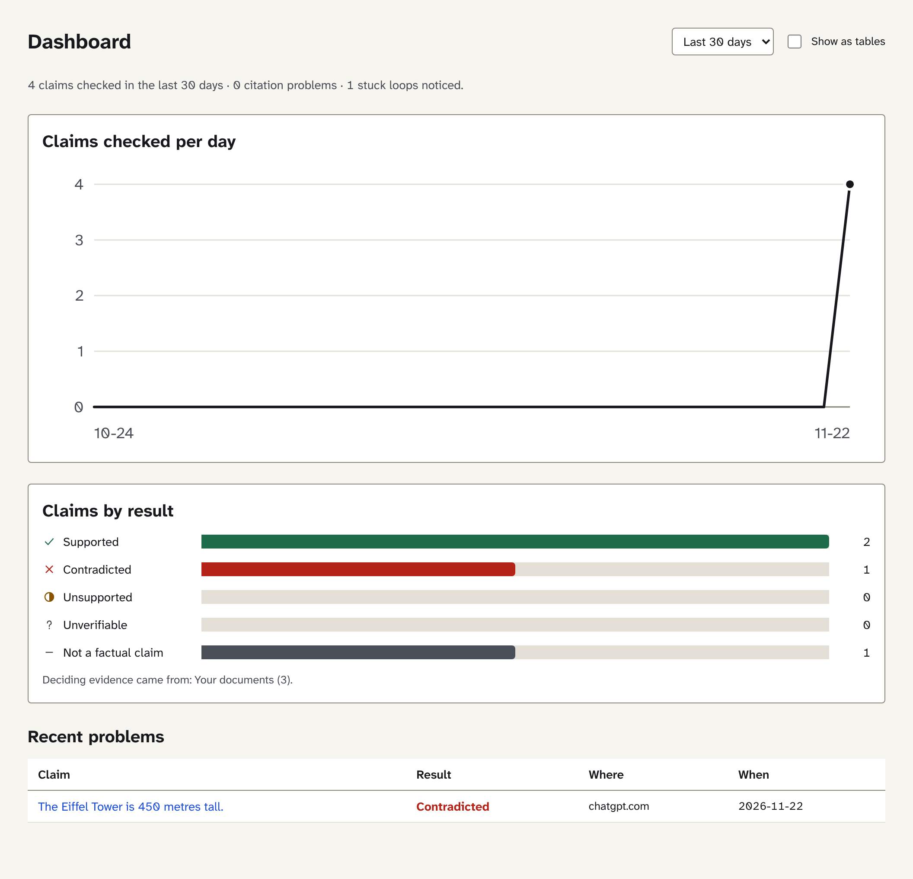</td>
<td valign="top"><b>Also</b> Citations: does the paper exist, do title, authors and year match Documents: compare an answer with your PDF or DOCX Calculations: arithmetic, percentages, unit conversions A chat that answers only from stored evidence</td>
</tr>
</table>

## Measured accuracy

SciFact dev (300 expert-labelled claims), never used for training or tuning. Full table: [docs/RESULTS.md](docs/RESULTS.md).

| Verifier | Accuracy | Macro-F1 | Contradiction F1 |
|---|---|---|---|
| Word matching (baseline) | 55.3% | 0.428 | 0.06 |
| DeBERTa-v3-base, zero-shot, 3 selected sentences | 60.0% | 0.595 | 0.64 |
| **DeBERTa-v3-large, zero-shot** | **65.0%** | **0.652** | **0.69** |
| DeBERTa-v3-large, searching all 5,183 abstracts | 54.3% | 0.542 | 0.55 |

Next: MultiVerS and fine-tuning. Target 80%; not reached yet.

<b>Privacy by design</b>

- Emails, API keys, card and phone numbers are **redacted before** anything is stored or sent.
- Every public source is **off** until you allow it; only the claim's own words are sent.
- The extension and desktop app read only what you ask them to check: no screenshots, no screen watching, no keystrokes.
- History is deleted after 30 days by default. Export or delete everything at any time.

## Honest limitations

- It doesn't catch every wrong answer. *Unsubstantiated* and *Insufficient evidence* do not mean *false*.
- The app still uses the word-matching verifier: a stronger model goes in only after it passes the benchmark gate
  (accuracy, contradiction handling, evidence relevance, licence, cost).
- Accuracy is measured on SciFact (scientific claims) only so far; everyday claims are next.
- Not yet run against live services: public-source lookups and SearXNG web search (tested with responses in their real
  formats), Google sign-in and Stripe (need your keys), and the desktop app against a deployed service. The Windows EXE
  builds and starts; a Windows checklist is part of the release process.

## Roadmap

| Done | Next |
|---|---|
| Claim, citation, document, code and calculation checks | Recursive and adaptive Deep research; research panel in every client |
| Research engine stage 1: multi-direction queries, providers, budgets, copies counted once | More sources: Wikidata, Crossref as evidence, OpenAlex |
| Web app, extension, Windows desktop app, accounts, plans | Sign in to the desktop app through the browser; first published Windows release |
| CI, safe migrations, error triage; SciFact benchmark with DeBERTa | MultiVerS and fine-tuned models; put the best one into the app |

## About the source code

This repository is the public overview of EvidenceTruth. The source code (backend, research engine, web app, browser extension, desktop app, tests and evaluation) is kept in a private repository. If you are reviewing my work for a role, open an issue or message me through my GitHub profile and I will give you read access or walk you through the code.

## Licence

All rights reserved. The text, diagrams and screenshots here may be viewed on GitHub; any other use needs
written permission. See [LICENSE](LICENSE).

If this project is interesting to you, a star helps others find it.

