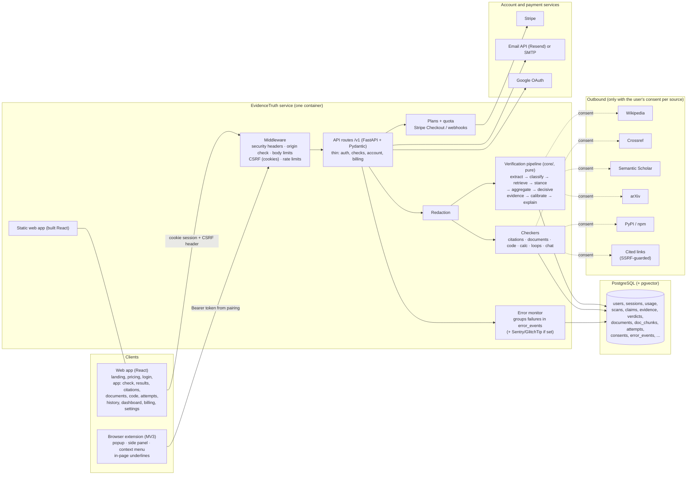

# Architecture: EvidenceTruth

How the product is built and how its parts connect: framework, database, auth and integrations.

---

## 1. System overview

One hosted service serves the API and the web app. The browser extension and the web app are two clients of the same API.

Separate and unchanged: `research/minimalproof` (video Proof Strip research module) does not import the service and is not deployed with it.

## 2. Framework

| Layer | Choice | Where |
|---|---|---|
| API | Python 3.12, FastAPI, Pydantic v2, Uvicorn | `backend/app` |
| Pure logic | Plain Python, no I/O (redaction, claim extraction, stance, aggregation, calibration, calculations, loops) | `backend/app/core` |
| Checkers | Orchestrate core + sources + database | `backend/app/checkers` |
| Network | httpx with timeouts, retries, cache, per-provider rate limits, circuit breaker, SSRF guard | `backend/app/sources` |
| Optional LLM | Any OpenAI-compatible endpoint (Ollama, vLLM). Writes explanations only, never labels | `backend/app/llm` |
| Web app | React 19, React Router 7, Vite 8, TypeScript (strict); own components on `design/tokens.css` | `frontend/` |
| Extension | Chrome/Edge Manifest V3, React, CSS Custom Highlight API for underlines | `extension/` |
| Shared UI | Claim card, claims list, icon set, types, copy | `shared/` |
| Desktop companion | Electron 45: floating circle, panel, tray, Ctrl+Shift+E checks copied text; token encrypted with the OS store | `desktop/` |

## 3. Database

| Store | Choice | Notes |
|---|---|---|
| App data | PostgreSQL 17 (managed) | SQLite works for local development and tests |
| Vectors | pgvector extension, enabled where available | Not used yet; retrieval is BM25 + public APIs |
| Migrations | Alembic, run only through `python -m app.store.migrate` | Backup (pg_dump) first; destructive steps need a one-time human code |
| Cache | `http_cache` table for public source responses | Holds no user identifiers |

Every user-owned table carries `user_id`, every query filters by it, and deleting a user cascades. Full table list: `docs/DATABASE.md`.

## 4. Auth

| Who | How |
|---|---|
| Web users | Email magic link (single use, 15 min, hashed) or Google (code + PKCE + state). No passwords stored |
| Web session | Random 256-bit token in an HttpOnly, SameSite=Lax cookie (Secure in production), stored as sha256, 30 days, revocable |
| Web writes | `X-ET-CSRF` header must match the `et_csrf` cookie, and `Origin` must be our site |
| Extension | 6-digit pairing code made in Settings (2 min, one use, lockout after 5 wrong tries) → bearer token (90 days, revocable) |
| Admin | `users.is_admin` for the error list; set by hand in the database |
| Stripe | Webhook signature verified with the signing secret; plan state changes only from webhooks |

Rules: constant-time comparisons, tokens never logged, no account enumeration on the magic-link form, sign-in and pairing rate limits. Details: `docs/security/02_LOGIN-RULES.md`.

## 5. Integrations

| Integration | Used for | Access |
|---|---|---|
| Wikipedia API | General facts | Public API, User-Agent with contact, cached. Per-user consent |
| Crossref REST | Citation existence and metadata | Public API, `mailto` set. Per-user consent |
| Semantic Scholar | Papers and abstracts | Public API, optional key. Per-user consent |
| arXiv API | Preprints | Public API. Per-user consent |
| PyPI JSON, npm registry | Package existence and age | Public. Per-user consent |
| Cited links | Link checks | Only public http(s) addresses on ports 80/443; private, loopback and link-local addresses are refused, also after redirects |
| Stripe | Checkout, Customer Portal, webhooks | `StripeClient.v1.*` (current SDK API) |
| Resend or SMTP | Magic links, bug-report mail | Server-side only |
| Google OAuth | Sign-in | Optional |
| Sentry SDK → GlitchTip | Error reports | Optional; scrubbed (no bodies, headers, breadcrumbs, user) |
| GitHub | Issues for triage and bug reports | Workflows only |

## 6. Request lifecycle

1. Middleware: body size (512 KB JSON, 25 MB documents) → origin check on writes → security headers.
2. Auth dependency: bearer token (extension) or cookie session (+ CSRF on writes).
3. Per-user rate limit, then Pydantic validation (400 with field messages).
4. Quota consumed for checks (402 when the month's plan limit is reached).
5. Redaction before anything is stored or sent.
6. Scans return at once with their claims; verification runs in a background task and results appear claim by claim (poll `GET /v1/scan/{id}` or stream `GET /v1/scan/{id}/events`).
7. Outbound calls only for providers the user allowed, only the claim's words.
8. Errors use `{code, message, hint}`. Unhandled errors are grouped in `error_events` and the user gets a short reference code.

## 7. Verification pipeline

1. **Extract**: sentence-level claims with exact spans (`core/extract.py`).
2. **Classify**: fact, opinion, prediction, hypothesis, subjective, math_technical. Only fact and math_technical are checked.
3. **Retrieve**: the user's documents (BM25, then single sentences or a two-sentence window when the sentence starts with a pronoun), then a multi-source investigation (`research/`, below). The page being checked is never evidence for itself.
4. **Stance**: `lexical-v2` by default, or an NLI cross-encoder with `ET_VERIFIER=nli`.
5. **Aggregate**: Supported needs a high-trust source; a stronger contradiction wins; related but undecided evidence → Unsubstantiated; nothing relevant → Insufficient evidence. Compound claims are split first (`core/decompose.py`) and their parent verdict is combined from the parts (`combine_parts`). Retrieval resolves the claim's entities to exact Wikipedia pages and drops passages that don't mention them (`rank_and_gate`).
6. **Decisive evidence**: backward elimination keeps the smallest set that gives the same label; it gets the yellow highlight.
7. **Abstain**: below 0.5 confidence the verdict is Insufficient evidence. (Temperature scaling exists in code but is not fitted yet.)
8. **Explain**: template by default; an LLM explanation is used only if it cites evidence IDs from the given list.

### 7a. Research engine (`backend/app/research/`, docs/plans/DEEP_RESEARCH.md)

- `queries.py` plans queries in three directions: support (entities + key words, exact wording for web search),
  contradict (myths, refutations) and context (the main subject).
- `providers.py` puts every source behind one `SearchProvider` interface: Wikipedia, Semantic Scholar, arXiv,
  and SearXNG when `ET_SEARXNG_URL` is set. `search()` only discovers; `fetch()` reads the document (web pages through
  the SSRF guard and `htmltext.py`). A title or snippet is never evidence.
- `orchestrator.py` runs one investigation within a `ResearchBudget` (requests, seconds, sources; enforced in
  `sources/base.HttpClient`). Pages that address instructions to automated systems are set aside. Passages must name
  the claim's main subject. `independence.py` groups copies (same owner, canonical URL, near-identical text, same DOI
  or same single cited study); at most two passages per group reach the verdict.
- The record (providers searched, failed, unavailable or not allowed; every query; every document and why it was or
  wasn't used; budget; stop reason) is stored in `research_runs` and served at `GET /v1/claims/{id}/research`.

## 8. Dependency rules

- `core/` is pure: no FastAPI, no HTTP, no database.
- Only `sources/` and `llm/` touch the network, after redaction and the consent check.
- Routes call checkers or core and do nothing else. `store/models.py` owns the schema.
- Destructive operations need human approval on every call (`docs/SECURITY.md` §5).
- New dependencies need a decision record.

## 9. Scaling

- One container, one worker: the rate limiter and the background tasks are in-process. To run several instances, move rate limits to Redis or Postgres and verification to a job queue (both are changes inside `security.py` and `routes_checks._bg_scan`).
- Postgres handles the load of many users; add indexes when the history list slows down.
- The NLI verifier needs about 1 GB of RAM; run it in a separate worker if enabled.

## 10. Failure handling

| Failure | Behaviour |
|---|---|
| A source times out or errors | Label from the remaining sources; "Some sources didn't respond" |
| Three failures in a row | That source is skipped for 60 s (circuit breaker) |
| No evidence | Insufficient evidence, worded neutrally, never "false" |
| LLM down or off | Template explanation |
| Quota used up | 402 with a link to plans |
| Payments not configured | Billing page says paid plans are not open; the free plan works |
| Unhandled error | 500 with a reference code; grouped in `error_events`; reopened if it comes back after being resolved |
| Destructive migration pending | Container refuses to start until a person approves it at a terminal |
